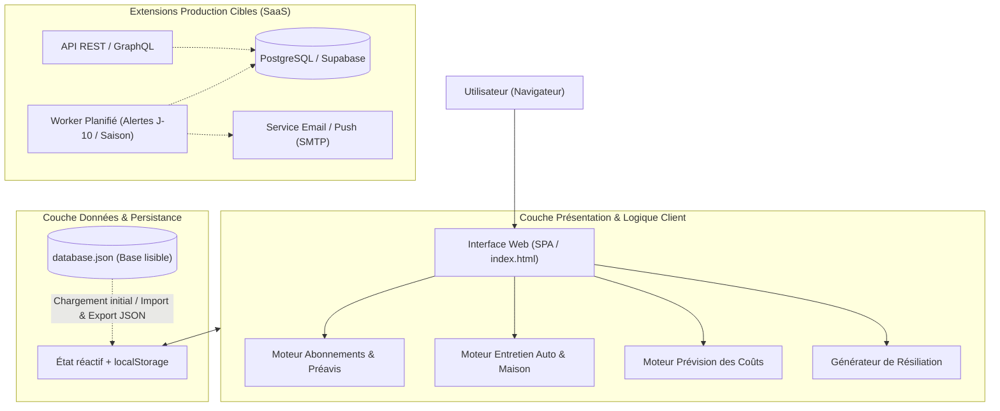

# Architecture de l'application Upkeeply

Ce document décrit l'architecture technique et fonctionnelle de **Upkeeply**, une plateforme tout-en-un combinant la **gestion proactive des abonnements/contrats** et le **carnet d'entretien préventif (véhicules & logement)**.

---

## 1\. Vue d'ensemble du système

Upkeeply repose sur une architecture modulaire articulée autour de quatre moteurs métier principaux :

1. **Moteur de suivi des abonnements & préavis** (*Subscription & Notice Engine*)  
   - Calcule automatiquement la date limite de résiliation (`noticeDeadline = nextRenewalDate - noticePeriodDays`).  
   - Déclenche des alertes anticipées avant la fin des essais gratuits ou des fenêtres de préavis.  
   - Génère des modèles d'e-mails ou de lettres de résiliation prêts à l'envoi.  
2. **Moteur d'entretien préventif** (*Preventive Maintenance Engine*)  
   - Suit les échéances selon trois types de déclencheurs : **kilométrique** (ex. vidange tous les 15 000 km), **saisonnier** (ex. purge des radiateurs à l'automne) et **calendaire** (ex. détartrage du chauffe-eau tous les 12 mois).  
   - Met à jour dynamiquement l'urgence lorsque le kilométrage d'un véhicule évolue.  
3. **Moteur de prévision budgétaire & d'économies** (*Cost Forecast & Waste Engine*)  
   - Agrège sur 12 mois les charges récurrentes (abonnements mensuels/annuels) et les estimations de coûts d'entretien à venir.  
   - Identifie les abonnements à faible usage pour simuler les économies annuelles potentielles.  
4. **Module d'acquisition & liste d'attente** (*Landing Page & Waitlist Capture*)  
   - Présente la proposition de valeur et enregistre les demandes d'accès anticipé.

---

## 2\. Diagramme d'architecture

&nbsp;

---

## 3\. Architecture du prototype Demo (Fichier unique)

Pour des raisons de simplicité de déploiement et de démonstration hors-ligne, le prototype repose sur une **architecture sans serveur (Zero-Backend)** :

| Fichier | Rôle | Détails |
| :---- | :---- | :---- |
| `index.html` | **Application Web complète** | Contient le HTML, le CSS (design system responsive sans dépendance externe) et toute la logique JavaScript (routage par onglets, calculs de dates/kilométrages, graphiques SVG natifs, modale de résiliation, simulateur d'économies et Landing Page). |
| `database.json` | **Base de données lisible** | Fichier JSON structuré et commenté par ses champs, servant de schéma de référence et de jeu de données initial. |
| `ARCHITECTURE.md` | **Documentation technique** | Spécification de l'architecture et du modèle de données. |

### Stratégie de chargement et persistance des données (`database.json` \+ `index.html`)

- **Ouverture via serveur HTTP** (`http://localhost:...`) : `index.html` tente automatiquement de charger `./database.json` via `fetch()`.  
- **Ouverture directe en fichier local** (`file:///.../index.html`) : Les navigateurs bloquant `fetch()` sur `file://` (CORS), l'application bascule de manière transparente sur une copie JSON intégrée à l'identique dans le HTML, puis persiste toutes les modifications de l'utilisateur dans `localStorage`.  
- **Synchronisation bidirectionnelle** : Un inspecteur de base de données intégré permet d'**importer** un fichier `database.json` modifié manuellement ou d'**exporter** l'état courant vers un nouveau `database.json`.

---

## 4\. Schéma de la base de données (`database.json`)

La base est structurée en 6 collections principales :

### `userProfile`

Profil de l'utilisateur utilisé pour pré-remplir les lettres de résiliation et définir le délai d'alerte par défaut (`alertLeadDaysDefault`, ex. 10 jours).

### `subscriptions[]`

Contrats et essais gratuits suivis.

- **Champs clés** : `serviceName`, `category`, `contractNumber`, `providerEmail`, `startDate`, `billingCycle` (`monthly` \| `yearly`), `amount`, `isFreeTrial`, `nextRenewalDate`, `noticePeriodDays`, `alertLeadDays`, `usageLevel` (`low` \| `high`), `status` (`active` \| `cancelled`).  
- **Règle de calcul** : $$\text{Date limite de préavis} = \text{nextRenewalDate} - \text{noticePeriodDays}$$ $$\text{Date d'alerte} = \text{Date limite de préavis} - \text{alertLeadDays}$$

### `assets[]`

Biens rattachés aux tâches d'entretien (`vehicle` avec `currentMileageKm` et `avgMonthlyKm`, ou `home`).

### `maintenanceTasks[]`

Règles et échéances d'entretien préventif.

- **Champs clés** : `assetId`, `title`, `category`, `triggerType` (`mileage` \| `seasonal` \| `time`), `intervalKm`, `lastPerformedMileageKm`, `intervalMonths`, `lastPerformedDate`, `nextDueDate`, `estimatedCost`, `serviceType`.  
- **Règle de calcul véhicule** : $$\text{Kilométrage cible} = \text{lastPerformedMileageKm} + \text{intervalKm}$$ $$\text{Distance restante} = \text{Kilométrage cible} - \text{currentMileageKm}$$

### `maintenanceLogs[]`

Historique horodaté des interventions réalisées (avec coût réel et kilométrage au moment de l'entretien).

### `waitlistLeads[]`

Contacts collectés via le formulaire *Call to Action / Waitlist* de la Landing Page.

---

## 5\. Évolution vers la production (SaaS)

Pour passer du prototype à une application SaaS multi-utilisateurs :

1. **Backend & Auth** : API Node.js/TypeScript ou Python (FastAPI) avec authentification OAuth2 / JWT.  
2. **Base de données relationnelle** : Migration directe des 6 collections JSON vers des tables PostgreSQL avec clés étrangères (`assets.id` \-\> `maintenance_tasks.asset_id`).  
3. **Worker de notifications** : Tâche CRON quotidienne vérifiant les fenêtres de préavis, les fins d'essais gratuits et les rappels saisonniers pour envoyer des e-mails / notifications push.  
4. **Envoi automatisé de résiliation** : Intégration SMTP ou API courrier recommandé pour envoyer la résiliation en un clic directement depuis l'application.